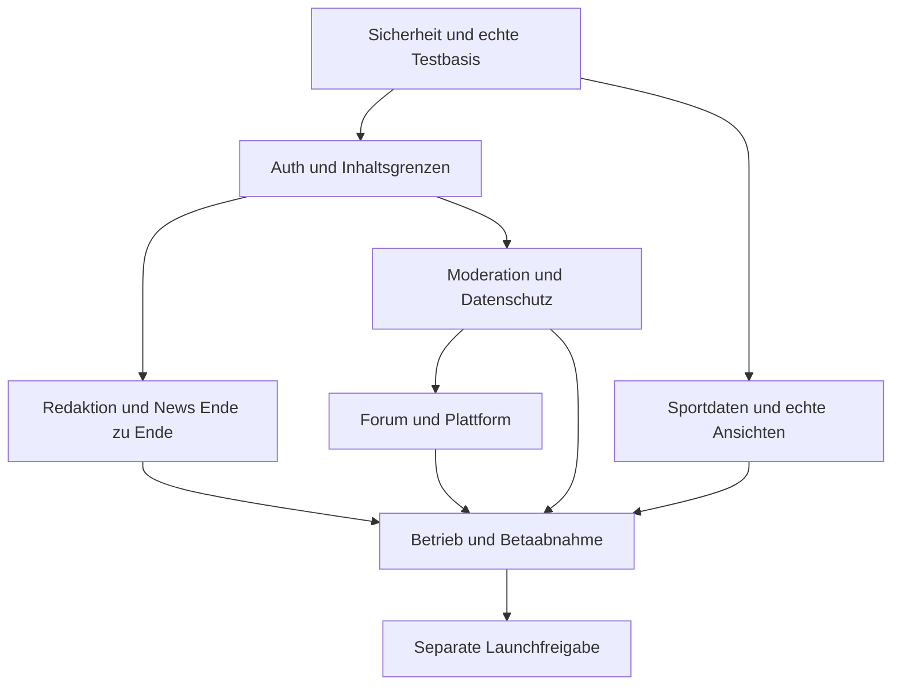

# Priorisierte Entwicklungsroadmap

Zur Freigabe; keine Implementierung oder Bereitstellung vorgenommen. Basis: `develop` @ `cabf1477136e0a4c8951655a11cf122cd834617e`.

## Priorisierung

Sicherheits- und Nachweisbarkeitsschulden zuerst schließen, bestehende Kernfunktionen danach vertikal fertigstellen. Forum-/Such-/Adminausbau parallel nur dort starten, wo Verträge und Berechtigungen stabil sind. Kein öffentliches Community-Beta ohne funktionsfähige Moderation. Keine ungeprüfte Gleichsetzung von 677 bestandenen Unit-/Helpertests mit End-to-End-Fertigstellung.

| Welle | Priorität | Konkretes Ergebnis | Hauptbezug | Abschlussgate |
|---|---|---|---|---|
| A – Sicherheits- und Testbasis | P0 | Runtime-/Tooling-Advisories triagiert/gepatcht; Diagnosequeue geschützt; ESM-E2E-Runner lauffähig; sämtliche Webtests in CI | F01–03, F09; 047, 252–257, 263–270, 295 | Frische Frozen-Installation, Build/Unit/Typechecks; keine unbehandelten erreichbaren Criticals; anonymer Diagnosezugriff abgelehnt; realer API-E2E-Test führt Assertions aus |
| B – Auth und sichere Inhaltsgrenzen | P1 | Tokenrefresh, serverseitiges Onboardinggate, UUID-/Bodyvalidation, Uploadprüfung, Logredaction, zentrale UI-Zugangsführung | F04, F06–07, F11–12, F14–15; 093–108, 127, 139, 255–257 | Echte Login/Verify/Onboarding/Club/Neutral/Refresh/Logout-Negativ-/Positivflows; Multipart-/Storage-Abnahme; keine Secretmarker in Logs |
| C – Redaktion und News als geschlossene Kette | P1 | Editor→Medien→Review→Artikel→Publish/Schedule mit Audit; Importapproval überführt Record zuverlässig in Artikel; Idempotenz und Retry/DLQ | F08, F13–14; 131–161, 240–241, 268 | Ein echter Fake-Provider-Durchlauf erzeugt nach Freigabe genau einen erwarteten Artikel; wiederholte/parallelisierte Zustellung sicher; OTS erst danach mit rechtlich/fachlich geklärtem Zugang |
| D – Moderation und Datenschutz-MVP | P1 | Karten/Sanktionen, Drei-Gelb→Rot, Revoke, Ablauf, Reportsbearbeitung, Notification-Outbox, Datenschutzfristen/Export/Löschung und Richtlinien | F05, F16; 172–191, 224–229, 246–251, 266, 271, 298–302 | Reale Kommentar→Report→Gelb→Rot→Revoke-Kette; LIMITED kann lesen/voten, nicht schreiben; konkurrierende Sanktionen sicher; Export/Löschung fachlich abgenommen |
| E – Echte Fußballansichten | P1/P2, unabhängig von Teilen C/D | Sportsvertrag/Fakeprovider, Management/Korrektur, Fixtures/Results, deterministische Tabellenberechnung, echter Seiteninhalt statt Mocks | F10; 121–124, 192–208, 269, 304–306 | Import/Update/Correction und österreichische Saison-/Phasen-/Tie-Breaker-Fixtures getestet; UI zeigt echte Daten oder klare Empty-/Errorstates |
| F – Forum und Plattform | P2 | Forum vertikal; Notifications/Preferences; Search/Reindex; rollenbasierter Admin, Auditviewer und gezielte Caches | 209–245, 258, 260–261 | Jeder vertikale Slice besitzt echte DB-/Worker-/Browserchecks; Outbox-Replay und Reindex aus PostgreSQL; Readtracking/Merge/Lock-RBAC geprüft |
| G – Betriebs- und Launchabnahme | Launch-Gate | Aktueller isolierter Restore, Monitoring/Alarme, Accessibility, SEO, Datenschutz/Security-Retest, Matchday-Lasttest, echte Beta/Feedback | F17–18; 272–314 | RPO/RTO, Warnschwellen, definierte Last-/A11ybudgets, geschlossene Beta ohne offene launchrelevante Critical/Highs; Freigaben dokumentiert |
| H – Soft/Public Launch und Stabilisierung | Erst nach separater Freigabe | Geprüfter Release, Live-KPIs, kontrollierter Registrierungsstart, Stabilisierung und nächste Version anhand Nutzungsdaten | 315–334 | Release-/Rollback-/Ownershipentscheidung; beobachtete SLOs und Datenschutzkonformität; kein Deployment aus diesem Auditauftrag |

## Sofortiger Start nach Freigabe

1. A01 Runtime-Advisories und A03 Diagnoseendpoint unabhängig bearbeiten; parallel A04 E2E-Runner und A05 Testauswahl.
2. A06 Authrefresh, A07 Server-Onboardinggate, A08 Uploadsecurity und A09 Param-/Loghärtung getrennt bearbeiten; gemeinsame Authverträge vor Merge abstimmen.
3. A10 Importreview-Übergang und A11 Idempotenz erst nach gemeinsamer Vertragsentscheidung; parallel Doku/MVP-Entscheidungen und Sportsvertragsarbeit.
4. Moderationsschema-/Eventänderungen einem Integrationsverantwortlichen zuweisen; danach Kartenkern, Revokeadapter und Ablaufworker mit festgelegten Schnittstellen parallelisieren.
5. Nach jeder Welle Statusmatrix nur anhand neuer Belege ändern. PARTIAL wird nicht allein durch einen weiteren Unit-Test DONE; die fehlenden Browser-/Staging-/Betriebsnachweise bleiben explizit.

## Fachliche Entscheidungen vor Umsetzung

- MVP-Scope/Meilenstein-Gates schriftlich festlegen (001–005); zusätzliche Wettbewerbe und BLUE-Karte bewusst einordnen.
- LIKE laut Masterplan versus UPVOTE/DOWNVOTE und Voterlisten entscheiden (072, 167); Sichtbarkeit der Votes datenschutzbewusst definieren.
- Redaktionelle Importübernahme: Draft nach Review oder Publikation mit eigener Publishpermission; Rechte und Quellen-/Bildlizenzen klären.
- Kartenrelevanz/Ablauffristen, Moderationseinspruch und parallele Sanktionen präzisieren; keine automatischen dauerhaften IP-Bans.
- Auth-Testrealm/SMTP-Testtransport/Storage-Testbucket und Fake-Provider als reproduzierbare Testressourcen, keine Produktionsdaten.
- Betreiber-/Juristenfreigaben für Rechtsdokumente und Datenfristen einholen. Private Secrets nur über sichere Umgebungssettings, niemals in Chat/Reports.

## Abhängigkeiten

Mögliche externe Blocker: echte SMTP/Google/OTS-/Storage-Testzugänge, Lizenzfreigaben, juristische Entscheidungen und später ausdrücklich autorisierte Staging-/Betriebsnachweise. Diese blockieren nicht die unabhängigen lokalen Test-/Security-/Vertragsarbeiten.
